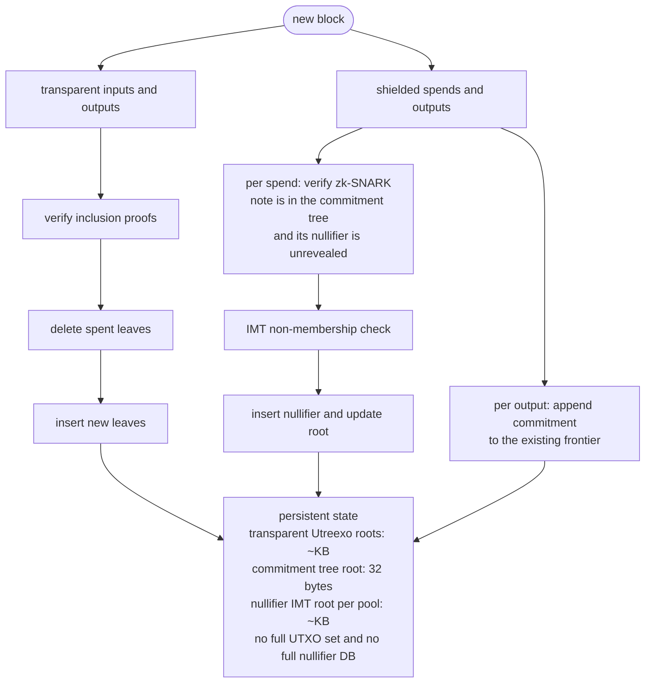

# zutreexo

Accumulator-based state compression for Zcash. Research-stage. Nothing here is production software yet.

The goal: let a Zcash validating node hold a few kilobytes of accumulator roots instead of a full transparent UTXO set and a full nullifier set — without weakening consensus, and without leaking which shielded note was spent.

## The problem

A Zcash full node keeps three growing structures in fast storage:

| Structure | What it is | Grows |
|---|---|---|
| Transparent UTXO set | Every unspent t-addr output | Insert + delete |
| Nullifier set (per pool) | "This note has been spent" tags | Insert only, forever |
| Note commitment tree (per pool) | Every shielded note ever created | Append only, forever |

Two of the three never shrink. Nothing is ever removed from the nullifier set or the commitment tree, because removal would reveal which note was spent — the exact linkage Zcash exists to prevent. So node state grows monotonically with chain history, and every shielded spend is validated against it.

Bitcoin has an answer to the analogous problem: Utreexo, Tadge Dryja's hash accumulator, which replaces the UTXO set with a forest of Merkle roots small enough to fit in a kilobyte. Nodes validate by verifying inclusion proofs attached to transaction inputs rather than by looking outputs up in a database.

This repo asks whether the same idea transfers to Zcash, and finds that it transfers to one of the three structures directly, one with a different primitive, and one not at all.

## The design, in one table

This is the load-bearing decision. The most common way to get this project wrong is to apply Utreexo uniformly.

| Structure | Operations needed | Right primitive | Why |
|---|---|---|---|
| Transparent UTXO set | insert + delete + membership | **Utreexo forest** | Identical to Bitcoin. Utreexo's forest-of-perfect-trees design exists precisely to make deletion cheap. Direct port. |
| Nullifier set | insert + **non**-membership | **Indexed Merkle Tree** | See below. |
| Note commitment tree | append + membership-in-zk | **Leave alone** | Already an append-only frontier; membership is proven inside the zk-SNARK. An accumulator adds nothing and would break the circuit. |

### Why nullifiers can't use Utreexo

A Utreexo forest — and a Merkle Mountain Range, and any unordered hash accumulator — proves membership only. Nullifier checking needs the opposite: proving a nullifier has **never** appeared. There is no way to prove absence from an unordered accumulator without holding the entire set, which defeats the purpose.

The fix is an Indexed Merkle Tree: each leaf stores `(value, next_value, next_index)`, keeping the set sorted via a linked list threaded through the leaves. Non-membership of `x` is proven by exhibiting the "low leaf" `L` where `L.value < x < L.next_value`, plus an ordinary Merkle path to `L`. Insertion touches two paths, `O(log n)`.

If someone proposes "just use Utreexo with deletion disabled" for nullifiers, that's the known failure mode. It cannot answer the question being asked.

## What this actually buys

Honest framing, because the obvious pitch is the wrong one.

**It does not make wallet sync faster.** Wallet sync is dominated by trial decryption — attempting to decrypt every shielded output with your viewing key, because that is the only way to learn a note is yours. No accumulator changes that. Projects like ZODL's Slipstream, hanh's Warp Sync, and Zingo's pepper-sync attack that cost, and they operate at a layer this project doesn't touch. They are complementary, not competitors.

What it does buy, now measured rather than projected ([`docs/benchmarks.md`](docs/benchmarks.md)):

- **`O(log n)` spend-detection instead of a linear scan.** Today a wallet learns its notes were spent by watching every block's revealed nullifiers go by — linear in the gap since last sync. With an IMT it asks for a non-membership proof per note: logarithmic, and independent of chain length. Non-membership verification measures **5.1 µs and flat** from 10⁴ to 10⁶ nullifiers at the production depth of 40. Against a year-long gap that is **317× to 31,705×** fewer bytes depending on how many notes the wallet holds, and proofs win past a gap of about 13 blocks for a one-note wallet.
- **Node state decoupled from chain history.** A compact node holds **693 bytes** where Zebra holds **31.7 GiB** — about 49,000,000:1 — and it does not grow with the chain.

And the costs, which are the more interesting half:

- **The headline query cannot be made privately, and something else already does it better.** Asking a bridge about a specific nullifier hands over a value only that note's owner could compute ([D35](docs/design.md)). Phases 6b and 6c built the one mitigation that survived scrutiny — prefix cohorts, where a wallet names a bucket instead of a nullifier — and measured per-note anonymity of 12,302 against **per-wallet anonymity of 1**: every simulated wallet is uniquely fingerprinted by the set of buckets it asks for ([D40](docs/design.md), [D41](docs/design.md)). Meanwhile `spendability-pir` ships the same partition-and-scan with the bucket index hidden by SimplePIR rather than by crowd size, at **1.78×** the bandwidth ([D44](docs/design.md)). For a light client, that is the better answer, and this repo says so.
- **Proofs add bandwidth.** Measured at **152.6%** overhead for a compact node doing IBD, after sparse encoding cut it from 170.5%.
- **The transparent forest stays.** Phase 5b reversed the expected narrowing: the transparent side is the cheap half, so dropping it would have kept the expensive one ([`PLAN.md`](PLAN.md)).

What remains genuinely ours is narrow, and stated that way: full history rather than a ~289-day window, a *proof* rather than an answer, and non-membership as a primitive a validator can check.

## Architecture



Note the per-pool parameterisation. Ironwood activated at block 3,428,143 (NU6.3) with Orchard restricted to withdrawals only, and withdrawal is discretionary — so Orchard drains slowly rather than emptying. Both nullifier sets are live indefinitely. One IMT per pool is mandatory, not defensive.

## Consensus posture

Phases 0–5 are consensus-neutral by construction. Proofs are supplied out-of-band by bridge nodes, not embedded in transactions. Nothing changes about which blocks a node accepts. This means the work can proceed, be measured, and be discarded without ever asking the network for anything.

Embedding proofs in the transaction format is a hard fork and is deliberately last, gated on whether the measurements justify it.

## Correctness approach

Differential testing against Zebra is the primary correctness signal. A green unit-test suite with a divergent root is a failure.

Two oracles, because they catch different bug classes:

1. **A naive `BTreeMap` model** — deliberately dumb, deliberately slow, sharing zero code with the accumulator so the two cannot be wrong in the same way. Catches accumulator bugs. The rule is enforced by a test that reads the oracle files as text and fails if they import what they check, because no compiler can enforce it.
2. **The validator's own answers** — catches parsing bugs, where both models agree because both were fed the same garbage.

Three comparison tiers:

| Tier | Runs | Compares |
|---|---|---|
| 1 — counts | every block | per-pool nullifier and UTXO counts against the naive model |
| 2 — cold roots | every N blocks | incremental roots against roots **recomputed from scratch** |
| 3 — validator | once per slice | our extracted totals against `zebrad`'s own JSON |

Tier 2 is the load-bearing one — it catches drift, which accumulates silently over a million-block replay and surfaces only when someone cannot spend.

All three are implemented and all four fixture slices pass. **Each tier is proven to fire by fault injection** rather than assumed to work: corruptions go into the implementation's input only, while the oracle still sees the truth, so an injected fault is indistinguishable from a real bug. Each has a paired test proving the *other* tiers are blind to it — without that pairing, a test proves only that something fired, not that the expensive tier was needed.

| Injected fault | Caught by | Provably blind |
|---|---|---|
| drop a nullifier | tier 1 | — |
| drop an output | tier 1 | — |
| reorder nullifiers within a pool | **tier 2** | tier 1 — counts are unchanged |
| undercount a note commitment | **tier 3** | tiers 1 and 2 — both read the same parse |

Plus reorg fuzzing, which is where accumulator implementations actually break. The invariant is byte-identical roots or failure — never "equivalent", never "same balance" — and **10⁶ randomised reorgs hold it**, each comparing the incrementally-maintained state against a cold replay of the chain that now exists.

Utreexo deletion turned out not to be invertible from a delta *at all*: `rustreexo` offers no way to reinsert a leaf at its former position. The nullifier trees roll back by delta, exactly; the transparent forest rolls back by snapshot and replay. See `docs/design.md` D18.

The fuzzer earned its place immediately, finding a serialisation bug that had been latent since Phase 1 — `Empty` node hashes were being read back as `Some`, which would have corrupted any snapshot of a forest that had ever seen a deletion.

## Status

| Phase | Scope | Status |
|---|---|---|
| 0 | Spike, baseline measurements, fixture capture | **complete** — measured at mainnet tip 2026-08-12, [`docs/benchmarks.md`](docs/benchmarks.md) |
| 1 | Accumulator core (Utreexo wrapper + IMT) | **complete** — DoD met as amended: 100% of *reachable* branches on `imt.rs` (83/88; the five that remain are defensive guards no public API can reach, enumerated in [`CLAUDE.md`](CLAUDE.md)) |
| 2 | Chain state transition + differential harness | **complete** — four fixture slices agree with an independent oracle and with `zebrad`; 10⁶ randomised reorgs replay byte-identical to a cold replay; **all 3.45M mainnet blocks replay from genesis to tip with zero errors** |
| 3 | Persistence, snapshots, crash consistency | **complete** — versioned atomic snapshots; 25 SIGKILLs mid-save left the store intact every time; restart costs 21 s instead of a 7-hour replay |
| 4 | Bridge node (proof serving) | **complete** — DoD met over a real socket; sparse paths cut wallet proofs 53.2% and bundle overhead to 152.6%. Transport is binary over HTTP, not gRPC ([D27](docs/design.md)) |
| 5 | Compact state node + published benchmarks | **complete** — the headline measured (above), storage 693 B against 31.7 GiB, and 500 blocks shadowed against Zebra at the live tip with zero divergences |
| 6 | Fuzzing, DoS analysis, privacy review | **complete** — fuzzing DoD met 7 of 7, privacy review written (and negative), external review dropped deliberately. Measurement work on what to optimise next continues as 6f, below |
| 7 | ZIP draft — gated on 5 and 6 | **gated shut** — CLAUDE.md requires that the benefit be real *and* the privacy review clean. The review is negative ([D35](docs/design.md)), Phases 6b–6c tried to change that and failed ([D40](docs/design.md), [D41](docs/design.md)), and [D44](docs/design.md) found deployed PIR doing the job properly. The gate holds for a better-understood reason than when it was first shut |

Phase 6 in detail, since it is where the work currently is:

| Step | Scope | Status |
|---|---|---|
| 6a | DoS hardening and the privacy review | slowloris denial from one idle socket closed ([D34](docs/design.md)); privacy review complete and **negative** ([D35](docs/design.md)); external-review requirement dropped deliberately, see [`PLAN.md`](PLAN.md) |
| 6b | Prefix cohorts — can the headline query be made private? | **built, measured, and re-scoped.** 12,288 members for 384.9 KB at 32 bytes a member ([D38](docs/design.md)), then per-wallet anonymity measured at 1 ([D40](docs/design.md)) |
| 6c | Serving cohorts: bridge methods and the epoch policy | **complete** — the request carries the bucket and never the value, asserted on the encoded bytes; a too-narrow prefix is refused rather than silently widened ([D42](docs/design.md), [D43](docs/design.md)) |
| 6d | Unblock the last two fuzz targets | **complete** — the upstream fix is pinned in *both* manifests, guarded by a test, after the duplicate pin made a working fix look falsified ([D33](docs/design.md)) |
| 6e | Fuzz budgets, and what "saturated" means | **complete** — the budgets were backwards ([D45](docs/design.md)); corrected, the next campaign ran 87.3 billion executions with zero crashes and met the DoD |
| 6f | What to optimise next | **in progress** — the planned proof re-encoding is worth 2.3% of a bundle and was dropped; a leaf cache saves 54.9% of transparent proof bytes at the tip, and what it costs a node in memory is being measured ([D46](docs/design.md)) |
| 6g | Retire the `rustreexo` fork | **complete** — crates.io 0.7.0 carries every upstream fix this project needed, so the build no longer depends on a fork; roots are byte-identical ([D47](docs/design.md)) |

**The fuzzing DoD ("72 h clean") is met for 7 of 7 targets**, as of the campaign that finished 2026-09-30: 87.3 billion executions, zero crashes, every target at or past 72 hours continuous. `snapshot_decode` — the target D45 identified as starved — ran 144 hours and was still finding new code three and a half days in.

Two results from the fuzzing worth stating on their own. **Three targets that looked stuck were simply finished** — measurement showed every reachable region of their decoders already covered, so the natural next move (write a structured input generator) would have bought nothing. And **a saturated target is not a useless one**: its product is the absence of a crash, which is a different claim from new coverage.

The nullifier indexed Merkle tree is implemented, differentially tested against an independent oracle, pinned with checked-in vectors, and benchmarked: non-membership verification is **5.1 µs and flat** from 10⁴ to 10⁶ nullifiers at the production depth of 40, which is the asymptotic claim this project rests on. See [`docs/benchmarks.md`](docs/benchmarks.md).

**The transparent side was blocked upstream, and is not any more.** `rustreexo` 0.6.0 generated invalid inclusion proofs for any leaf whose sibling had been deleted — reproduced with stock upstream types, so it was not our domain separation. This project carried the fix in a fork ([D25](docs/design.md)) until upstream shipped it. Fuzzing this project's decoders later found three more bugs in the same crate: a panic and an unbounded recursion that overflows the stack, both reachable from a serialized forest ([D33](docs/design.md)), plus a `serialize` that panics instead of returning the error its signature promises when the writer fails ([our PR](https://github.com/mit-dci/rustreexo/pull/160)). **All of them are fixed in crates.io `rustreexo` 0.7.0, and the fork is retired** ([D47](docs/design.md)); [`crates/zutreexo-accumulator/tests/upstream_rustreexo.rs`](crates/zutreexo-accumulator/tests/upstream_rustreexo.rs) guards against a future release regressing them. The nullifier IMT is unaffected — it depends on nothing but BLAKE2b.

Decisions taken so far, with reasoning, are in [`docs/design.md`](docs/design.md). The phased plan with per-phase definitions of done is in [`CLAUDE.md`](CLAUDE.md). Current status, branch naming, and the gaps being carried deliberately are in [`PLAN.md`](PLAN.md).

## Build and test

```bash
cargo test --workspace --locked     # unit, differential, vector, and property tests
cargo clippy --workspace --all-targets --locked -- -D warnings
cargo bench -p zutreexo-accumulator

# Phase 1 definition of done
PROPTEST_CASES=10000 cargo test --release -p zutreexo-accumulator --test properties

# The differential harness at its strictest: a cold root rebuild after every
# block, at a deeper tree. Needs the full fixture corpus (see below).
ZUTREEXO_HARNESS_DEPTH=14 ZUTREEXO_ROOT_CHECK_EVERY=1 \
  cargo test --release -p zutreexo-testkit --test harness_replay
```

### Fuzzing

Seven targets, budgeted per target rather than on one clock, because time to saturation across them spans from execution 101 to eighteen hours. [`fuzz/README.md`](fuzz/README.md) explains the budgets and how to read a run.

```bash
cargo +nightly fuzz run bundle_decode -- -max_total_time=600
nohup scripts/fuzz_72h.sh > fuzz-runs/driver.log 2>&1 &   # the full campaign
scripts/fuzz_saturation.py                                 # what a run actually bought
```

### Fixtures

One 200-block slice (`fixtures/nu5-orchard.jsonl`, 1.85 MB) is committed, because every test touching `zutreexo-chain` is gated on a fixture being present — with all of them ignored, CI executed none of that crate. The other three slices are 63 MB and stay gitignored; regenerate them with `scripts/measure_baseline.sh` against a synced node. Tests skip, loudly, when a slice is absent.

## Open questions

This is a build-to-learn exercise. Discovering that an answer makes the work redundant is a valid outcome, and reaching it by building beats reaching it by speculating — which is roughly what happened.

**Resolved, and not in this project's favour:**

- **Does PIR subsume the nullifier use case?** For a light client asking "was my note spent", yes. `spendability-pir` is deployed and wired into wallets, and it costs 1.78× the bandwidth of the mechanism built here while giving a privacy property the crowd-based approach measurably does not have ([D44](docs/design.md)). This was originally framed as "does Tachyon subsume this", treated as a blocking gate, and dropped as a gate in August; the answer arrived anyway, from a different direction, and it was worth more as a measurement than the gate would have been as a wait.
- **Will NU7 change block times?** Not a live consideration here. Capacity ceilings are derived from transaction counts rather than block counts, so a block-time change moves nothing that was fixed on that basis.

**Still open:**

- **Is the authenticated, full-history path worth anything to anyone?** It is what survives D44: a proof rather than an answer, no window limit, and a primitive a validator could check. Nobody has asked for it.
- **Would the compact-node result survive a real deployment?** 693 bytes against 31.7 GiB is measured, but against one node, on one box, shadowing 500 blocks.

## Licensing

MIT OR Apache-2.0, matching `librustzcash` and Zebra. `deny.toml` enforces the boundary — notably against AGPL dependencies, which would relicense the whole project.

## Prior art

- **[Utreexo](https://eprint.iacr.org/2019/611)** — Dryja, ePrint 2019/611. The original accumulator. [`rustreexo`](https://github.com/mit-dci/rustreexo) is the Rust implementation.
- **Indexed Merkle Trees** — the non-membership structure, as used in Aztec's nullifier tree.
- **[Zebra](https://github.com/ZcashFoundation/zebra)** — the Rust Zcash validator; our oracle.
- **[Zaino](https://github.com/zingolabs/zaino)** — the Rust indexer replacing `lightwalletd`; likely integration point for the bridge node rather than a fork of our own.
- **Slipstream, Warp Sync, pepper-sync** — wallet sync engines. Different layer; read them to understand what this project is *not* solving.
- **[spendability-pir](https://github.com/valargroup/spendability-pir)** and its Ironwood fork [p2p-spendability-pir](https://github.com/distractedm1nd/p2p-spendability-pir) — private spend-status lookup with SimplePIR over a bucketed hash table. Structurally the same partition-and-scan as this project's prefix cohorts, with the bucket index hidden by cryptography instead of by crowd size. Read [D44](docs/design.md) before reading the cohort code.
- **[Zakura](https://github.com/zakura-core/zakura)** — a Zebra fork with native pruning and much faster sync, and the node the PIR work above runs against.

## Contributing

Too early for feature contributions. What's useful right now: review of the design decision in the table above, and answers to the two open questions. Open an issue.
